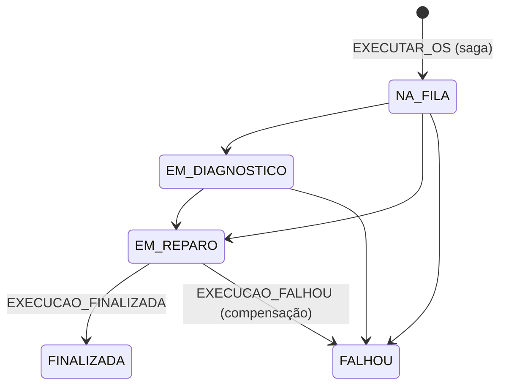

# Oficina — Execution Service

Microsserviço de **execução e produção** da oficina mecânica (Tech Challenge SOAT — Fase 4).
Mantém a fila de trabalho dos mecânicos: recebe as OS já pagas, acompanha diagnóstico e reparo e avisa
o OS Service quando o serviço termina — ou quando não dá para terminar, o que dispara a compensação
da saga (estorno do pagamento).

| | |
|---|---|
| Linguagem | Java 21 / Spring Boot 3.4 |
| Banco | **PostgreSQL** (Cloud SQL) — database e usuário exclusivos (`execucao_<ambiente>`) |
| Mensageria | Google Pub/Sub, com **transactional outbox** |
| Observabilidade | New Relic APM + distributed tracing, métricas Micrometer, logs JSON com `correlationId`/`sagaId` |

## Índice

1. [Responsabilidades](#1-responsabilidades)
2. [Arquitetura do serviço](#2-arquitetura-do-serviço)
3. [Papel na saga](#3-papel-na-saga)
4. [API](#4-api)
5. [Como executar](#5-como-executar)
6. [Testes e cobertura](#6-testes-e-cobertura)
7. [CI/CD](#7-cicd)
8. [Kubernetes](#8-kubernetes)

## 1. Responsabilidades

- Gerenciar a fila de execução das OS (prioridade e ordem de chegada).
- Atualizar o status durante o diagnóstico e o reparo (`NA_FILA → EM_DIAGNOSTICO → EM_REPARO → FINALIZADA`).
- Comunicar a finalização (ou a falha) ao OS Service.



## 2. Arquitetura do serviço

```
src/main/java/br/com/fiap/challange/execucao/
├── domain/              Execucao (regras de transição), StatusExecucao, ports
├── application/usecase/ ExecucaoUseCase
└── infrastructure/
    ├── adapter/in/rest/        ExecucaoController (só funcionários; cliente recebe 403)
    ├── adapter/in/messaging/   ComandosSagaListener (idempotente)
    ├── adapter/out/persistence JPA + Flyway (execucoes, itens, histórico, outbox)
    ├── adapter/out/mensageria  OutboxEventosAdapter + RelayOutbox
    └── messaging/              Pub/Sub (publicação, assinatura, propagação de trace)
```

**Outbox**: cada mudança de status grava o evento na tabela `outbox_mensagens` **na mesma transação**
da execução; o `RelayOutbox` publica no Pub/Sub a cada segundo. Se o broker cair, o evento fica guardado
e sai depois — nunca acontece de o status mudar sem o OS Service ficar sabendo. A métrica
`oficina.outbox.pendentes` mostra quantos eventos estão esperando.

## 3. Papel na saga

| Mensagem | Direção | Quando |
|---|---|---|
| `EXECUTAR_OS` | OS Service → Execution | pagamento confirmado; a OS entra na fila |
| `EXECUCAO_ATUALIZADA` | Execution → OS Service | diagnóstico ou reparo iniciado (OS vai para *Em Execução*) |
| `EXECUCAO_FINALIZADA` | Execution → OS Service | serviço concluído (OS *Finalizada*, saga concluída) |
| `EXECUCAO_FALHOU` | Execution → OS Service | não foi possível executar → OS cancelada, peças devolvidas e **estorno do pagamento** |

## 4. API

Swagger: `/execucao/swagger-ui.html` (local: http://localhost:8082/execucao/swagger-ui.html).

| Método | Rota | Descrição |
|---|---|---|
| GET | `/api/execucoes/fila` | fila (prioridade, depois ordem de chegada) |
| POST | `/api/execucoes/proxima` | mecânico pega a próxima OS (inicia o diagnóstico) |
| GET | `/api/execucoes/{id}` | execução com itens e histórico |
| GET | `/api/execucoes/ordem-servico/{osId}` | execuções de uma OS |
| POST | `/api/execucoes/{id}/diagnostico` | inicia diagnóstico |
| POST | `/api/execucoes/{id}/reparo` | inicia reparo |
| POST | `/api/execucoes/{id}/finalizar` | conclui (`{"observacoes": "..."}`) |
| POST | `/api/execucoes/{id}/falha` | registra falha (`{"motivo": "..."}`) e dispara a compensação |

## 5. Como executar

```bash
docker run -d -p 5433:5432 -e POSTGRES_DB=execucao -e POSTGRES_USER=execucao -e POSTGRES_PASSWORD=execucao123 postgres:16-alpine
./mvnw spring-boot:run
```

Ambiente completo (3 serviços + emulador do Pub/Sub): `docker-compose.yml` do repositório
[`oficina`](https://github.com/robsonago/oficina#como-executar).

## 6. Testes e cobertura

```bash
./mvnw verify
```

- Unitários do domínio e do caso de uso.
- Integração (Spring Boot + H2 com as migrations Flyway): comando da saga → fila → diagnóstico → reparo →
  finalização, falha, prioridade, segurança e a outbox segurando o evento quando a publicação falha.
- Adaptadores do Pub/Sub contra o **emulador oficial** (Testcontainers).
- Build falha abaixo de **80%** de cobertura de linhas. Cobertura atual: **96%**.

## 7. CI/CD

[`.github/workflows/ci-cd.yml`](.github/workflows/ci-cd.yml): Build e Testes → Qualidade (SonarCloud) →
imagem `ghcr.io/robsonago/oficina-execution-service:<sha>` → deploy no GKE com `k8s/overlays/<ambiente>`.
Branch `main` protegida (PR obrigatório + checks).

## 8. Kubernetes

```
k8s/
├── base/        Deployment (app + Cloud SQL Auth Proxy), Service, HPA (1–3 réplicas)
└── overlays/    homolog | producao
```

O banco `execucao_<ambiente>`, o usuário `execucao` e a service account `oficina-execucao` vêm do
Terraform em [`oficina-infra-db`](https://github.com/robsonago/oficina-infra-db); ConfigMap, Secret,
Workload Identity e permissões no Pub/Sub, de [`oficina-infra-k8s`](https://github.com/robsonago/oficina-infra-k8s).
